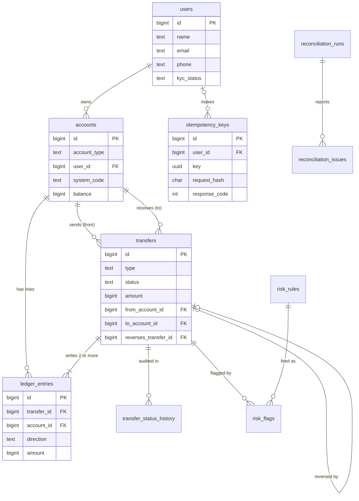

# Schema design (Milestone 1)

The schema is `migrations/001_init.sql`. It builds the whole database from empty: `docker compose up` runs it
on startup (`app/migrate.py`, guarded by an advisory lock and recorded in `schema_migrations`), and every
test run builds throwaway databases from it.

Money is whole paise in `BIGINT`. Sign convention: **a credit increases an account's balance, a debit decreases it**,
so `balance = SUM(credits) - SUM(debits)`. System accounts may go negative (CASH_IN is debited on every top-up).

## 1. Noun list

Every noun in the requirements, and why it did or did not become a table.

| Noun | Table? | Why |
|---|---|---|
| user | **yes** `users` | Has its own attributes (name, email, phone, KYC status) and a lifecycle. |
| name, email, phone, KYC status | no | Attributes of a user. |
| wallet | **yes** `accounts` | Has a balance, a currency and its own lifecycle. Shares a table with system accounts. |
| currency | no | One value (INR); a `CHECK (currency = 'INR')`, not a table. |
| system account (cash-in, cash-out, fee revenue) | **yes** `accounts` | Same shape as a wallet minus an owner. |
| balance | no | A column on `accounts` (a cache of the ledger, see below). |
| transfer | **yes** `transfers` | The business event; ledger lines hang off it. |
| transfer type, status | no | Constrained columns on `transfers`. |
| amount, created time | no | Columns. |
| ledger entry | **yes** `ledger_entries` | One debit or credit line; many per transfer. |
| debit / credit | no | The `direction` column. |
| reversal | no | A transfer with `type = 'reversal'` pointing at the original via `reverses_transfer_id`. |
| idempotency key | **yes** `idempotency_keys` | Needs a request hash, a status and the saved response. |
| statement | no | A query over `ledger_entries`. |
| nightly report, mismatch | **yes** `reconciliation_runs`, `reconciliation_issues` | The brief says to save them. |
| job lock | **yes** `job_locks` | Required by Milestone 4 (`FOR UPDATE NOWAIT`). |
| fraud rule | **yes** `risk_rules` | Thresholds must live in the database, not in code. |
| flag | **yes** `risk_flags` | Which rule fired on which transfer, plus the LLM explanation and label. |
| audit log | **yes** `transfer_status_history` | Who changed a transfer's status, and when. |
| question, answer | no | A stateless endpoint; nothing needs to be remembered. |
| fee | no (a transfer type) | `fee` is a `transfers.type`; a fee on a payment would be a separate two-sided transfer in the same DB transaction. No endpoint creates one yet. |

## 2. Attributes

Every table has a system-generated `BIGINT GENERATED ALWAYS AS IDENTITY` primary key. Table names are plural
snake_case, column names singular.

| Table | Direct attributes |
|---|---|
| `users` | name, email, phone, kyc_status (`pending`/`verified`/`rejected`), created_at |
| `accounts` | account_type (`user_wallet`/`system`), user_id (null for system), label, system_code (null for wallets), currency, balance, created_at |
| `transfers` | type, status (`pending_review`/`completed`/`rejected`), amount, from_account_id, to_account_id, initiated_by, reverses_transfer_id, note, created_at, completed_at |
| `ledger_entries` | transfer_id, account_id, direction, amount, created_at |
| `idempotency_keys` | user_id (null for callers with no user), key, request_hash, endpoint, status, response_code, response_body, transfer_id, created_at |
| `transfer_status_history` | transfer_id, from_status, to_status, changed_by, reason, changed_at |
| `risk_rules` | code, description, threshold_value, window_seconds, action (`hold`/`flag`), enabled, updated_at |
| `risk_flags` | transfer_id, rule_id, action_taken, details, llm_explanation, llm_label, decision, reviewed_by, reviewed_at, created_at |
| `reconciliation_runs` | started_at, finished_at, status, checks_run, issue_count (distinct root causes), triggered_by, note |
| `reconciliation_issues` | run_id, check_name, subject_type, subject_id, expected, actual, group_key, detail |
| `job_locks` | job_name (primary key), locked_at |

## 3. Cardinality and foreign keys

| Relationship | Cardinality | Foreign key |
|---|---|---|
| user - accounts | 1 : M (a user may have many wallets; a system account has no user) | `accounts.user_id`, nullable |
| transfer - ledger entries | 1 : M (at least 2) | `ledger_entries.transfer_id` |
| account - ledger entries | 1 : M | `ledger_entries.account_id` |
| account - transfers as sender | 1 : M | `transfers.from_account_id` |
| account - transfers as receiver | 1 : M | `transfers.to_account_id` |
| transfer - its reversal | 1 : 0..1 | `transfers.reverses_transfer_id`, `UNIQUE` |
| user - idempotency keys | 1 : M (0..M: user-less callers store NULL) | `idempotency_keys.user_id`, `UNIQUE (user_id, key)` |
| transfer - status history | 1 : M | `transfer_status_history.transfer_id` |
| transfer - risk flags | 1 : M | `risk_flags.transfer_id` |
| risk rule - risk flags | 1 : M | `risk_flags.rule_id` |
| reconciliation run - issues | 1 : M | `reconciliation_issues.run_id` |

There is no M:N relationship, so no mapping table. Each foreign key sits on the "many" side. The two
account foreign keys on `transfers` are two separate 1:M relationships (a transfer has exactly one sender
and one receiver), not an M:N between accounts.

## 4. ER diagram

## 5. What the database enforces

These hold even if the application code is wrong.

| Guarantee | Mechanism |
|---|---|
| A user wallet's balance never goes negative; system accounts may | `CHECK (account_type = 'system' OR balance >= 0)` |
| A wallet has an owner and no system code; a system account the reverse | `accounts_owner_shape` CHECK |
| One currency | `CHECK (currency = 'INR')` |
| Entry and transfer amounts are positive | `CHECK (amount > 0)`, direction in its own column |
| Ledger entries are never updated or deleted | `BEFORE UPDATE OR DELETE` row trigger and `BEFORE TRUNCATE` trigger raising an error |
| Debits equal credits for every transfer | `DEFERRABLE INITIALLY DEFERRED` constraint trigger, checked at COMMIT after all lines are inserted |
| A transfer cannot send to itself | `CHECK (from_account_id <> to_account_id)` |
| A reversal always points at a transfer, and only a reversal does | `CHECK ((type = 'reversal') = (reverses_transfer_id IS NOT NULL))` |
| A transfer is reversed at most once | `UNIQUE (reverses_transfer_id)` |
| An idempotency key is unique per user | `UNIQUE (user_id, key)`, plus a partial unique index on `key WHERE user_id IS NULL` for user-less callers |
| Every status change is audited with who and when | Trigger on `transfers` writes `transfer_status_history`; the application sets `app.actor` per transaction |
| Email and phone are unique | `UNIQUE` indexes on `lower(email)` and `phone` (not keys) |

### Signed amounts or positive amounts plus direction?

Positive `amount` plus a `direction` column. `CHECK (amount > 0)` rules out zero or nonsense lines, "total debits
versus total credits" reads directly as two sums, and a reader can see a line's direction without decoding a sign.
Signed amounts would make balance sums simpler (`SUM(amount)`), but they hide the direction and allow a zero line.

## 6. Indexes, and what each costs on writes

Every index is extra work on every INSERT (and on UPDATE of its columns), so each one below exists for a query that is run.

| Index | Serves | Write cost |
|---|---|---|
| `idx_ledger_account_time (account_id, created_at DESC, id DESC)` | The statement (`WHERE account_id = ? ORDER BY created_at DESC, id DESC`), both OFFSET and keyset paging | 2 entries per transfer, so 2 index inserts per transfer |
| `idx_ledger_transfer (transfer_id)` | Reconciliation checks 2 and 6 (measured about 2x faster with it, see README), `GET /transfers/{id}`, and the deferred balance trigger's lookup | 2 index inserts per transfer |
| `idx_transfers_from_time (from_account_id, created_at DESC)` | Fraud rules VELOCITY and AMOUNT_SPIKE | 1 per transfer |
| `idx_transfers_to_time (to_account_id, created_at DESC)` | Statement Q&A (received), "last 10 transfers" for flag explanations | 1 per transfer |
| `idx_transfers_pair (from_account_id, to_account_id)` | Fraud rule NEW_PAYEE_LARGE | 1 per transfer |
| `idx_transfers_held (created_at) WHERE status = 'pending_review'` | Admin risk queue; partial, so it only holds the few held rows and normal transfers pay nothing | none for completed transfers |
| `idx_accounts_user (user_id)` | Finding a user's wallets (Q&A) | wallets are created rarely |
| `idx_idempotency_created (created_at)` | The 24-hour key cleanup | 1 per POST |
| `idx_risk_flags_unexplained (created_at) WHERE llm_label IS NULL` | The nightly explanation job; partial | only unexplained flags |
| `idx_status_history_transfer`, `idx_recon_issues_run`, `idx_risk_flags_transfer` | Looking rows up by their parent | low volume |

`transfers` has six indexes (the primary key, the `UNIQUE` on `reverses_transfer_id`, `from_time`, `to_time`, `pair`,
and the partial `held` one). A normal transfer inserts into the first five. It also writes two ledger rows, each into
the ledger's primary key and its two secondary indexes. That is the heaviest write amplification in the schema.
Measured transfer latency is in the README.

## 7. Stored balance or computed balance?

Both. The stored `accounts.balance` is a cache that also serves as the row to lock; the ledger is the source of truth
and the nightly job proves they agree. See the README for the trade-offs.

## 8. Other tables that are not in the diagram

`schema_migrations (filename, applied_at)` is created by the migration runner, not by a migration file.
